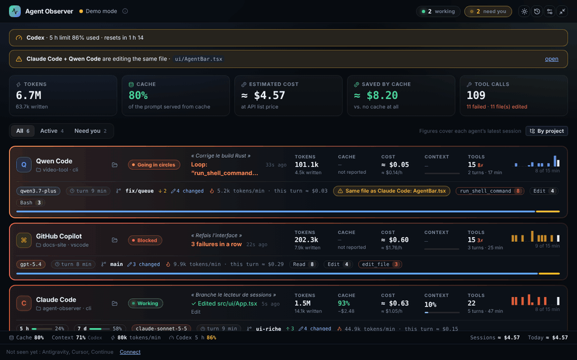
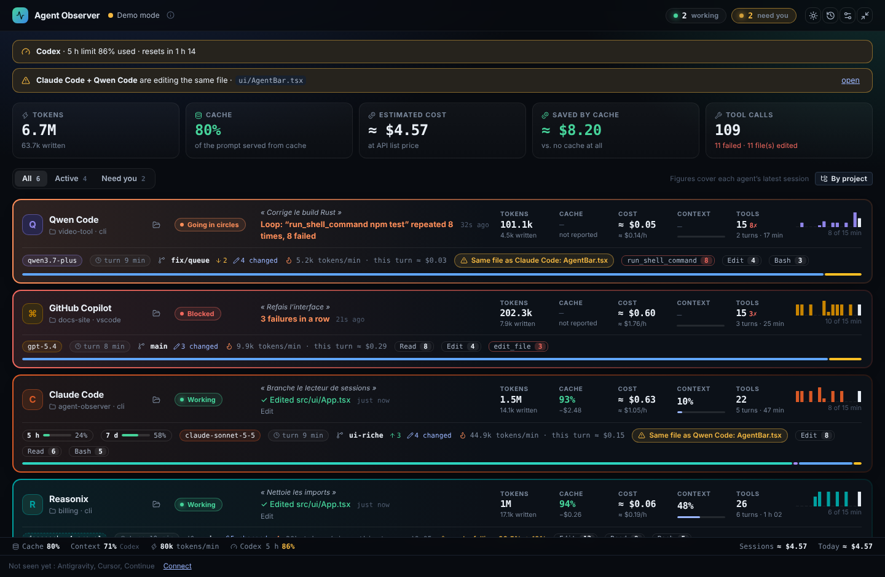
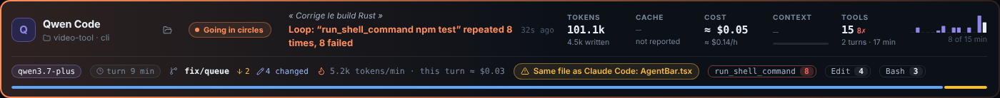
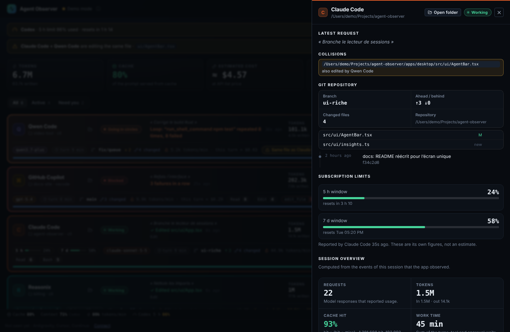

<div align="center">

# Agent Observer

**Vois ce que font tes agents de code — et lequel a besoin de toi — sur un seul écran, sans rien envoyer nulle part.**

Une application de bureau locale pour macOS, Windows et Linux qui regarde travailler, en direct, Claude Code,
Codex, GitHub Copilot, Antigravity, OpenCode, Qwen Code, Reasonix, Cursor et Continue sur ta machine.

[](https://github.com/jcalhinho/agent-observer/actions/workflows/ci.yml)
[](https://github.com/jcalhinho/agent-observer/releases)
[](LICENSE)

[Installer](#installation) · [Brancher tes agents](#brancher-tes-agents) · [Ce que tu vois](#ce-que-tu-vois) · [Lire les chiffres](#lire-les-chiffres) · [Serveur MCP](#pour-tes-agents--un-serveur-mcp-en-lecture-seule) · [Confidentialité](#confidentialité-et-données) · [Dépannage](#dépannage) · [Développer](#compiler-et-développer) · [English](README.md)



</div>

---

## Sommaire

- [Pourquoi](#pourquoi)
- [Démarrage rapide](#démarrage-rapide)
- [Installation](#installation) — une ligne, installateurs, macOS, Windows, Linux, Homebrew, mises à jour, désinstallation
- [Brancher tes agents](#brancher-tes-agents) — Claude Code, Cursor, les agents lus automatiquement
- [Ce que tu vois](#ce-que-tu-vois) — barre du haut, alertes, barres, états, détail, barre d'état, historique, mode colonne
- [Lire les chiffres](#lire-les-chiffres) — ce que veut dire chaque chiffre et d'où il vient
- [Limites d'abonnement](#limites-dabonnement)
- [Alertes, notifications et budget](#alertes-notifications-et-budget)
- [Réglages](#réglages)
- [Pour tes agents : un serveur MCP en lecture seule](#pour-tes-agents--un-serveur-mcp-en-lecture-seule)
- [Agents sur une autre machine](#agents-sur-une-autre-machine)
- [Confidentialité et données](#confidentialité-et-données) — ce qui est gardé, où, et comment l'effacer
- [Dépannage](#dépannage)
- [Compiler et développer](#compiler-et-développer) — tests, mode démo, organisation, publication
- [Contribuer](#contribuer) · [Licence](#licence)

## Pourquoi

Faire tourner deux ou trois agents de code en parallèle est devenu normal. Savoir lequel a fini, lequel
attend ton accord et lequel échoue sur la même commande depuis cinq minutes, beaucoup moins. Agent
Observer répond à une seule question d'un coup d'œil : **qui a besoin de moi maintenant ?** — puis te dit
ce que coûte chaque agent, à quel point son contexte est rempli, et où tu en es de tes limites d'abonnement.

Il ne fait qu'**observer**. Il ne pilote jamais un agent, ne modifie jamais ton code ni les réglages d'un
agent à ta place, et n'envoie aucune télémétrie. Il ne fait aucune requête réseau de lui-même, sauf la
recherche de mise à jour que tu lances toi-même (voir [Mettre à jour](#mettre-à-jour-et-désinstaller)).

> **État :** début de vie (0.x). L'interface existe en **français et en anglais** ; elle suit la langue
> du système et se change dans les Réglages.

## Démarrage rapide

1. **Installe** (macOS ou Linux) :
   ```bash
   curl -fsSL https://raw.githubusercontent.com/jcalhinho/agent-observer/main/install.sh | bash
   ```
   Sous Windows, lance le `-setup.exe` de la [page des versions](https://github.com/jcalhinho/agent-observer/releases).
2. **Ouvre l'app.** Codex, Copilot, Antigravity, OpenCode, Qwen Code, Reasonix et Continue sont repérés tout seuls.
   Pour **Claude Code** (et Cursor), ouvre **Réglages › Agents › Configurer** et colle le bloc affiché dans
   le fichier de réglages de l'agent — voir [Brancher tes agents](#brancher-tes-agents).
3. **Travaille comme d'habitude.** Chaque agent a sa barre dès sa première action. Les plus urgents passent devant.

Pas d'agent sous la main ? Lance l'interface en mode démo : `npm run dev` dans `apps/desktop`, puis ouvre
`http://127.0.0.1:1420/?demo` (données inventées, rien n'est lu ni écrit).

## Installation

### En une ligne, macOS et Linux

```bash
curl -fsSL https://raw.githubusercontent.com/jcalhinho/agent-observer/main/install.sh | bash
```

Le script choisit le fichier qui correspond à ton système et à ton processeur dans la **dernière version
publiée**, le vérifie avec le `SHA256SUMS.txt` de la version, puis l'installe :

| Système | Installé dans | Ce qu'il fait |
| --- | --- | --- |
| macOS (Apple Silicon ou Intel) | `/Applications/RepoWatcher Agent Observer.app` | Monte le `.dmg`, ferme la copie en cours, remplace l'app, l'ouvre. |
| Linux x86_64 | `~/.local/bin/agent-observer` | Installe l'AppImage (demande FUSE 2 : `libfuse2` sous Ubuntu). |

Options, en variables d'environnement : `AGENT_OBSERVER_VERSION=0.13.3` (une version précise),
`AGENT_OBSERVER_DRY_RUN=1` (montre ce qu'il ferait, sans rien changer), `AGENT_OBSERVER_REPO=owner/repo`
(un fork). Lis [`install.sh`](install.sh) avant si tu préfères. Un fichier téléchargé avec `curl` n'est pas
mis en quarantaine par macOS : l'app non signée s'ouvre directement. Relance la même ligne pour **mettre à jour**.

### Installateurs

Sur la [page des versions](https://github.com/jcalhinho/agent-observer/releases) ; vérifie-les avec le
`SHA256SUMS.txt` de la même version.

| Plateforme | Fichier |
| --- | --- |
| macOS, Apple Silicon (M1 et suivants) | `Agent-Observer_<version>_macos-arm64.dmg` |
| macOS, Intel | `Agent-Observer_<version>_macos-x64.dmg` |
| Windows 10/11, installation par utilisateur (recommandée) | `Agent-Observer_<version>_windows-x64-setup.exe` |
| Windows 10/11, MSI pour le déploiement géré | `Agent-Observer_<version>_windows-x64.msi` |
| Linux x86_64, Debian / Ubuntu | `Agent-Observer_<version>_linux-x64.deb` |
| Linux x86_64, toute distribution | `Agent-Observer_<version>_linux-x64.AppImage` |
| Serveur MCP pour tes agents | `agent-observer-mcp.mjs` (voir [Serveur MCP](#pour-tes-agents--un-serveur-mcp-en-lecture-seule)) |

> [!IMPORTANT]
> Les versions ne sont **pas encore signées** avec un Developer ID Apple ni un certificat de signature
> Windows : ton système t'avertira au premier lancement. Les étapes ci-dessous sont la façon habituelle
> d'ouvrir une application de confiance. Dans le doute, [compile-la toi-même](#compiler-et-développer).
> Sur un ordinateur professionnel, suis la politique logicielle de ton organisation plutôt que de la contourner.

### macOS

1. Ouvre le `.dmg` et glisse **RepoWatcher Agent Observer** dans **Applications**.
2. Ouvre-la une fois depuis **Applications**. macOS dit qu'il ne peut pas vérifier le développeur.
3. Autorise-la :
   - **macOS 15 Sequoia et suivants :** clique sur **Terminé**, ouvre **Réglages Système → Confidentialité
     et sécurité**, descends jusqu'au message sur l'app, clique sur **Ouvrir quand même**, confirme avec ton mot de passe.
   - **macOS 14 et antérieurs :** dans le Finder, **clic droit (ou Contrôle-clic) sur l'app → Ouvrir**, puis **Ouvrir**.

Si macOS dit que l'app **« est endommagée et ne peut pas être ouverte »**, c'est le marquage de quarantaine
d'une app non signée, pas un vrai dommage :

```bash
xattr -dr com.apple.quarantine "/Applications/RepoWatcher Agent Observer.app"
```

### Windows

1. Lance `…-setup.exe`. Il installe pour l'utilisateur courant, sans droits d'administrateur.
2. Si **Microsoft Defender SmartScreen** affiche *« Windows a protégé votre ordinateur »*, clique sur
   **Informations complémentaires → Exécuter quand même**.
3. WebView2 est déjà présent sous Windows 10/11 ; l'installateur le récupère s'il manque.

Vérifier un téléchargement dans PowerShell : `Get-FileHash .\Agent-Observer_*_windows-x64-setup.exe -Algorithm SHA256`.
[`docs/WINDOWS.md`](docs/WINDOWS.md) est une courte liste de ce qu'il faut voir pour chaque agent sous Windows.

### Linux

- **Debian / Ubuntu :** `sudo apt install ./Agent-Observer_<version>_linux-x64.deb` (installe `libwebkit2gtk-4.1-0`, `libgtk-3-0` et `libayatana-appindicator3-1`).
- **Toute distribution :** `chmod +x Agent-Observer_<version>_linux-x64.AppImage && ./Agent-Observer_<version>_linux-x64.AppImage`
  (demande FUSE 2). L'AppImage est construite sous Ubuntu 22.04 et tourne sur les systèmes au moins aussi récents.

### Homebrew (expérimental)

Chaque version contient `agent-observer.rb`, un cask pour un tap personnel. Avec un dépôt
`<toi>/homebrew-tap` et le secret `HOMEBREW_TAP_TOKEN` (voir [Publier une version](#publier-une-version)),
publier une version le copie dans `Casks/` du tap ; ensuite :

```bash
brew install --cask <toi>/tap/agent-observer
```

Sans le secret, copie le fichier dans `Casks/` toi-même. Homebrew abandonne progressivement les apps non
signées par Apple : cela peut cesser de marcher tant que l'app n'est pas signée.

### Premier lancement

Une seule copie tourne à la fois : la relancer ramène la fenêtre existante au premier plan. L'état à côté
du logo indique **Collecte active** quand le collecteur local écoute. Ensuite, [branche tes agents](#brancher-tes-agents).

### Mettre à jour et désinstaller

- **Mettre à jour :** dans une version construite avec une clé de signature des mises à jour,
  **Réglages › Mises à jour › Vérifier** cherche une version publiée plus récente, et **Installer et redémarrer**
  la télécharge, vérifie sa signature avec la clé intégrée à l'app, l'installe et relance l'app. L'app ne
  contacte GitHub que quand tu cliques. Sinon (et ça marche toujours) : relance la ligne d'installation, ou
  installe la nouvelle version par-dessus. Ton historique est gardé dans les deux cas.
- **Désinstaller :** supprime l'app (macOS : glisse-la dans la Corbeille ; Windows : *Paramètres › Applications* ;
  Linux : `sudo apt remove repo-watcher-agent-observer` ou supprime l'AppImage). Pour effacer aussi tes données,
  supprime les dossiers listés dans [Où sont tes données](#où-sont-tes-données), et retire les hooks et la barre
  d'état ajoutés aux réglages de tes agents.

## Brancher tes agents

| Agent | Comment il est observé | Ce que tu dois faire |
| --- | --- | --- |
| **Claude Code** | Ses [hooks HTTP](https://docs.claude.com/en/docs/claude-code/hooks) officiels envoyés au collecteur local, plus les tokens lus dans les nouvelles lignes de ses transcriptions (`~/.claude/projects/**.jsonl` ; `CLAUDE_CONFIG_DIR` respecté). | Coller le bloc de hooks (ci-dessous). Facultatif : la barre d'état, pour les limites d'abonnement. |
| **Cursor** | Ses hooks envoyés au collecteur local. | Coller le bloc de hooks (ci-dessous). |
| **Codex** | Les nouvelles lignes de ses journaux dans `~/.codex/sessions` (`CODEX_HOME` respecté), limites d'abonnement comprises. | Rien. |
| **GitHub Copilot** | Les journaux de son agent dans `~/.copilot/session-state/<session>/events.jsonl` (Copilot CLI et sessions d'agent de VS Code ; `COPILOT_HOME` respecté), et le panneau Copilot Chat de VS Code (sa base locale `session-store.db`, en lecture seule). | Rien. |
| **Antigravity** | Ses fichiers locaux dans `~/.gemini/antigravity`, en lecture seule (liste des conversations et, pour les sessions récentes, le détail étape par étape). Le nom du modèle vient du serveur local d'Antigravity (voir [Confidentialité](#confidentialité-et-données)). | Rien. |
| **OpenCode** | Sa base SQLite (`~/.local/share/opencode/opencode*.db` ; `OPENCODE_DB` / `OPENCODE_DATA_DIR` respectés), en lecture seule. | Rien. |
| **Qwen Code** | Les nouvelles lignes de ses discussions dans `~/.qwen/projects/<projet>/chats`. | Rien. |
| **Reasonix** | Ses fichiers de session dans `~/.reasonix/projects/<projet>/sessions/*.wire.jsonl`, en lecture seule. | Rien. |
| **Continue** (VS Code) | Les journaux locaux que l'extension écrit à chaque réponse, chaque appel de modèle et chaque outil (`~/.continue/dev_data/0.2.0/*.jsonl` ; `CONTINUE_GLOBAL_DIR` respecté), et le dossier de projet de chaque conversation dans `~/.continue/sessions/<id>.json`. Voir [Continue](#continue). | Rien. |

Sous Windows, `~` est `%USERPROFILE%`. **Réglages › Agents › Configurer** montre, pour chaque agent, le dossier
lu et s'il a été trouvé.

**L'historique n'est pas importé.** Les lecteurs partent de la fin des fichiers existants et n'observent
que la nouvelle activité, à partir du moment où l'app tourne ; tout ce qui est observé est ensuite gardé
(dans la limite de ta rétention). Une barre Copilot Chat apparaît avec ta prochaine conversation.

### Claude Code

1. Dans l'app, **Réglages › Agents › Claude Code › Configurer** affiche un bloc de hooks qui contient déjà
   la clé de cette installation.
2. Ouvre `~/.claude/settings.json` (Windows : `%USERPROFILE%\.claude\settings.json`).
3. Ajoute l'entrée `"hooks"` du bloc à l'objet existant — fusionne-la avec tes hooks éventuels, ne remplace
   pas le fichier. Elle couvre `UserPromptSubmit`, `PreToolUse`, `PostToolUse`, `PostToolUseFailure`, `Stop`,
   `Notification` et `SessionEnd`, chacun en hook `http` vers `http://127.0.0.1:43821/claude-hook` avec un
   délai de 2 secondes.
4. Les nouvelles sessions de Claude Code apparaissent aussitôt. Si l'app est fermée, les hooks abandonnent
   après 2 secondes sans gêner Claude Code.

La clé est propre à cette installation : si tu installes l'app sur un autre ordinateur, recopie le bloc.
L'app ne modifie jamais `settings.json` elle-même.

**Facultatif — limites d'abonnement.** Claude Code ne donne ses limites de 5 heures et de la semaine qu'à
sa barre d'état. La même fenêtre propose un bloc `statusLine` : ajoute-le à `settings.json` et la barre d'état
devient `modèle · ctx · 5h · 7d` tout en transmettant les limites à l'app (il utilise `curl` ; il remplace ta
propre barre d'état si tu en as une ; app fermée, la barre reste vide). Voir [Limites d'abonnement](#limites-dabonnement).

### Cursor

**Réglages › Agents › Cursor › Configurer** affiche un bloc de hooks pour `~/.cursor/hooks.json`
(Windows : `%USERPROFILE%\.cursor\hooks.json`). Fusionne-le avec le contenu existant et redémarre Cursor.
Les hooks lisent la clé de cette installation dans son fichier et transmettent chaque événement au collecteur
(PowerShell sous Windows, `python3` sous macOS et Linux) ; ils abandonnent après 3 secondes si l'app est fermée.
Cursor ne rapporte pas de tokens : ses barres affichent « non rapporté » pour eux.

### Continue

Continue écrit trois journaux locaux, lus au fur et à mesure :

- `chatInteraction.jsonl` — une ligne par réponse du chat : sa session et le titre du modèle. La question et
  la réponse qu'elle contient aussi ne sont jamais lues dans un événement.
- `tokensGenerated.jsonl` — une ligne par appel de modèle : le modèle et les tokens que **Continue compte
  lui-même avec son tokenizer** (pas les chiffres du fournisseur) ; ils sont donc marqués estimés et le coût
  s'affiche avec **≈**. Une ligne n'a pas de session : elle est rattachée à la réponse du chat qui la suit dans
  les 30 secondes chez le même fournisseur. L'autocomplétion, les modifications et les titres ne sont
  rattachés à aucune réponse et ne sont pas comptés.
- `toolUsage.jsonl` — une ligne par appel d'outil : son nom, si tu l'as accepté et s'il a réussi (jamais ses
  arguments ni sa sortie). Pas de session non plus : il appartient à la conversation de la dernière réponse.

Continue ne rapporte pas son cache, et rien ne marque le début d'un tour (ton message n'est pas dans ces
journaux) : son nombre de tours reste à 0 et aucun temps de travail n'est affiché.

### Non branchés

- **Gemini CLI** — remplacé par Antigravity dans cette app ; rien n'en est lu.
- **Cline, Roo Code** — Cline est en train de passer le stockage de ses tâches à un nouveau format (son code
  contient un lecteur de l'ancien format, « pre-SDK », à côté du nouveau) ; un connecteur suivra quand le
  format sera stabilisé.
- **Aider** — il garde un fichier d'historique dans chaque dépôt, sans endroit commun à surveiller.

Les sessions lancées dans un agent cloud ou une application de bureau qui ne laisse rien sur ton ordinateur
ne peuvent pas être observées. Pour ajouter un agent, voir [Ajouter un connecteur](#ajouter-un-connecteur).

## Ce que tu vois

### L'écran



- **Barre du haut** — l'état du collecteur, les compteurs (**au travail**, **t'attendent**), la dépense du jour
  face à ton budget quand tu en fixes un, et quatre boutons : **thème clair / sombre**, **historique**,
  **réglages** et **réduire en colonne**.
- **Alertes** — sous la barre du haut : un agent proche de sa limite d'abonnement, le budget du jour bientôt
  atteint ou dépassé, deux agents qui modifient le même fichier ou travaillent dans le même dossier (avec un lien pour l'ouvrir).
- **Bandeau de totaux** — la dernière session de chaque agent additionnée : tokens, taux de cache, coût estimé,
  ce que le cache a fait économiser, appels d'outils (avec échecs et fichiers modifiés).
- **Filtre** — **Tous / Actifs / T'attendent**, et **Par projet** : les barres rangées sous le nom de leur
  dossier de projet, dans le même ordre (choix retenu).
- **Une barre par agent**, les plus urgentes devant (tourne en rond, bloqué, silencieux, t'attend, au travail,
  au repos). Clique sur une barre, ou appuie sur Entrée dessus, pour ouvrir son détail.
- **Barre d'état** — toujours en bas (voir plus loin).
- **Pas encore vus** — un pied de page liste les agents qui n'ont rien envoyé, avec un lien pour les brancher.



### Une barre

La première ligne dit qui, son état et ce qu'il fait, puis les mêmes chiffres pour tous les agents, alignés
d'une barre à l'autre. Une seconde ligne porte le reste. Survole n'importe quel élément pour son explication.

| Bloc | Ce qu'il montre |
| --- | --- |
| **Identité** | L'agent, le dossier du projet (`~` pour ton dossier personnel) et la façon dont il a été lancé (cli, vscode…). L'icône de dossier ouvre le dossier du projet (seulement des dossiers, jamais un fichier). |
| **État** | Un mot, coloré selon l'urgence (tableau plus bas). |
| **Activité** | L'outil en cours et son fichier ou sa commande, et l'âge du dernier événement. Une boucle détectée ou des échecs en série la remplacent, en couleur. |
| **Objectif** | Ta dernière demande à l'agent, en italique (seulement si la capture des prompts est activée). |
| **Tokens** | Le total de la session, et combien ont été écrits (sortie). |
| **Cache** | Le taux de cache, et ce que le cache a fait économiser. |
| **Coût** | Le coût estimé de la session, et le $/h pendant que l'agent travaille. |
| **Contexte** | Le remplissage de la fenêtre de contexte, avec une petite jauge. |
| **Outils** | Les appels d'outils, les échecs (✗), les tours et la durée. |
| **Bande d'activité** | Les événements par minute sur les 15 dernières minutes. |
| **Seconde ligne** | Limites d'abonnement (5 h, 7 j), modèle (`+N` s'il y en a plusieurs), durée du tour en cours, branche git / avance / retard / fichiers modifiés, tokens par minute et coût de ce tour, une alerte « cache en chute », les collisions, et les outils les plus utilisés avec leurs échecs. |
| **Bande du bas** | La répartition des tokens : cache lu, cache écrit, entrée nouvelle, sortie. |

Le filet dégradé de chaque barre prend la couleur de l'agent, orange quand il tourne en rond, rouge quand il est bloqué.

### Les états

| État | Sens |
| --- | --- |
| **Tourne en rond** | Il répète les mêmes actions sans avancer (même commande, même fichier, même enchaînement parmi ses 24 derniers appels) — il brûle des tokens pour rien. |
| **Bloqué** | Au moins deux outils ont échoué d'affilée (dans les 10 dernières minutes). |
| **Silencieux** | Un tour est ouvert mais rien ne s'est passé depuis plus de 2 minutes — souvent, il attend ta validation. |
| **T'attend** | Son dernier tour est terminé (dans les 30 dernières minutes) ; il attend ton prochain message. |
| **Au travail** | Des événements sont arrivés dans les 45 dernières secondes, ou son tour a commencé il y a moins de 2 minutes. |
| **Au repos** | Pas d'activité récente. |
| **Pas encore vu** | Rien reçu — vérifie son connecteur. |

### Le panneau de détail

Clique sur une barre. Le panneau s'ouvre sur :

1. **La dernière demande** (avec la capture des prompts), **les collisions** et **le dépôt git** (branche,
   avance / retard, fichiers modifiés, derniers commits) avec un bouton **Ouvrir le dossier**.
2. **Les limites d'abonnement** de cet agent, avec leurs heures de remise à zéro (Codex et Claude Code).
3. **La vue d'ensemble de la session**, où chaque chiffre a sa définition dessous : requêtes, tokens en entrée
   et en sortie, taux de cache avec les nombres exacts de tokens lus et manqués, temps de travail, coût estimé,
   fenêtre de contexte.
4. **La session** : dernière activité, durée, tours, événements, fichiers modifiés, échecs d'outils.
5. **Les sessions précédentes** : les 20 plus récentes avant celle-ci, lues dans la base locale — leur début,
   leur durée (du premier au dernier événement), leur projet, les appels d'outils et les échecs, les tokens
   et le coût estimé.
6. **Tokens, cache et coût** : le détail complet, le coût sans cache, ce que le cache a fait économiser, et la
   table des prix derrière l'estimation.
7. **La tendance du cache**, **le rythme**, **la courbe du contexte** (avec les compactions), **les modèles**,
   un **tableau des outils**, **les fichiers touchés** (lus ou modifiés) et une **chronologie** des dernières actions.



`Échap` ferme le panneau, comme un clic à côté.

### La barre d'état

En bas de l'écran, toujours visible : le **taux de cache** de tous les agents (survole-le pour les nombres
exacts de tokens lus et manqués), le **contexte le plus rempli** et son agent, les **tokens par minute** des
agents au travail, la **limite d'abonnement la plus proche**, le coût des **dernières sessions** et celui
d'**aujourd'hui**.

### L'historique

Le bouton horloge de la barre du haut. Choisis **Aujourd'hui, 7, 30 ou 90 jours** :

- **La dépense** (estimée), avec le nombre de jours chiffrés et de requêtes sans prix connu.
- **Les tokens**, avec l'entrée répartie entre lus du cache et manqués ; **le taux de cache** ; **les requêtes**
  et **les jours actifs**.
- **Les tokens par jour** et **la dépense par jour**, tracés à part (unités différentes).
- **Jour par jour** : tokens, cache, requêtes, coût, économie, sessions et échecs d'outils.
- **La répartition par agent, modèle ou projet.**

Les jours avec de l'usage mais sans coût chiffré sont signalés : ce ne sont pas des jours gratuits, leur
modèle n'est simplement pas dans la table des prix. L'historique demande à la base locale ce qu'il additionne
(les événements avec des tokens, les échecs d'outils et une ligne par session et par quart d'heure pour compter
les sessions), pas chaque événement ; sa profondeur est ta durée de rétention.

### Mode colonne et thème

- **Réduire en colonne** (en haut à droite) transforme la fenêtre en une colonne étroite sur le bord droit de
  l'écran, au premier plan par défaut (le bouton épingle l'en libère). Les barres s'adaptent à la largeur.
  L'autre bouton rend la grande fenêtre, à sa taille et à sa place d'avant. L'app se souvient du mode au lancement suivant.
- **Thème clair / sombre** — le bouton soleil / lune. Le thème clair est un gris clair, sans aucun fond blanc.
  Le choix est retenu.

### Barre des menus / zone de notification

L'app met une icône dans la barre des menus de macOS, la zone de notification de Windows ou la zone
d'état de Linux. Sous macOS et Linux elle affiche combien d'agents t'attendent (rien quand aucun) ; son
info-bulle et son menu le disent en toutes lettres, et le menu ouvre la fenêtre ou quitte l'app. Sous Linux il
faut `libayatana-appindicator3` ; sans elle l'app tourne sans l'icône.

## Lire les chiffres

Chaque chiffre vient de ce que l'agent rapporte lui-même. Une valeur qu'il ne rapporte pas s'affiche
**« — »** ou **« non rapporté »**, jamais inventée. Une valeur estimée le dit (**≈**), et une estimation
partielle affiche **≥**.

| Chiffre | Sens |
| --- | --- |
| **Tokens** | Tout ce que l'agent a rapporté pour la session : entrée nouvelle + cache lu + cache écrit + sortie. |
| **Écrits** | Les tokens de sortie (ce que le modèle a généré). |
| **Cache lu / cache écrit / entrée nouvelle** | Les tokens du prompt servis par le cache du fournisseur, écrits dans ce cache, et envoyés à neuf. |
| **Taux de cache** | Cache lu ÷ (cache lu + cache écrit + entrée nouvelle), soit **lus ÷ (lus + manqués)**. Seulement pour les agents qui rapportent leurs lectures de cache (Claude Code, Reasonix, Codex…). Plus c'est haut, moins ça coûte : garde le début du prompt stable. |
| **Cache en chute** | Les dernières requêtes touchent beaucoup moins le cache qu'avant (le début du prompt a changé, ou le cache a expiré) : tout est relu au plein tarif. |
| **Coût estimé** | Ce que coûteraient les mêmes tokens au **tarif API public** de chaque modèle (`apps/desktop/src/ui/pricing.ts`). Un abonnement ne facture pas ainsi. Un modèle absent de la table des prix est laissé de côté, et le coût affiche alors **≥**. |
| **Économisé par le cache** | Le coût des mêmes requêtes en comptant chaque token mis en cache comme une entrée normale, moins le coût estimé. |
| **$/h, tokens/min** | Le rythme sur les 15 dernières minutes, pendant que l'agent travaille. |
| **Ce tour** | Le coût estimé depuis le début du tour en cours. |
| **Contexte** | Ce que la prochaine requête emporterait (la taille du dernier prompt) ÷ la fenêtre de contexte du modèle. Orange dès 80 %, rouge dès 95 %. La fenêtre vient de l'agent quand il la rapporte, sinon d'une table de modèles documentés ; pour un modèle inconnu, aucun pourcentage n'est affiché. |
| **Compactions** | Le nombre de fois où l'agent a réduit son contexte. |
| **Tours** | Les messages que tu as envoyés (Codex : ses marqueurs de tour ; Cursor : ses événements `stop` ; Continue : non rapporté, 0). |
| **Requêtes** | Les réponses du modèle qui ont rapporté leur usage. |
| **Temps de travail** | La somme des tours, de chaque message à la dernière activité avant le suivant : attentes d'outil et de validation comprises, pas les pauses entre deux tours. Pas affiché pour Cursor et Continue (pas de marqueur de tour). |
| **Durée** | Le temps écoulé entre le premier et le dernier événement de la session. |
| **Fichiers modifiés** | Les fichiers distincts changés par un outil d'édition / écriture / patch ou signalés comme modifiés. |

## Limites d'abonnement

Ce qu'un abonné veut savoir, c'est ce qu'il lui reste avant la limite, pas un montant en dollars. L'app
montre les limites **uniquement telles que les agents les rapportent** :

- **Codex** les écrit dans ses journaux de session à chaque requête (`rate_limits` : fenêtres de 5 heures et
  de la semaine, pourcentage utilisé, heure de remise à zéro). Rien à faire : elles sont lues au démarrage dans
  le dernier fichier, puis en direct. Abonnement ChatGPT seulement, pas avec une clé d'API.
- **Claude Code** ne les écrit nulle part sur le disque : il ne les donne qu'à sa barre d'état (abonnés Pro et
  Max). Ajoute la barre d'état facultative depuis **Réglages › Agents › Claude Code** (voir [Claude Code](#claude-code)) ;
  les limites apparaissent après sa prochaine réponse.
- Les autres agents n'en rapportent pas.

Elles s'affichent sur la barre de l'agent (`5 h ▬ 24 %`, `7 j ▬ 58 %`), dans son détail avec les heures de
remise à zéro, dans la barre d'état (la plus proche) et en alerte dès 80 % (rouge dès 95 %). Seuls les
pourcentages, la durée des fenêtres, les heures de remise à zéro et le nom de l'offre sont gardés, **en mémoire**.
Une fenêtre remise à zéro depuis le dernier relevé est affichée comme telle, pas avec son ancien pourcentage.

## Alertes, notifications et budget

| Quoi | Dans l'app | Notification système |
| --- | --- | --- |
| Un agent se met à tourner en rond, se bloque ou devient silencieux | l'état et le filet de sa barre | oui |
| Un agent finit et t'attend (après avoir travaillé) | son état | oui |
| Deux agents modifient le même fichier (en 20 minutes), ou travaillent dans le même dossier (en 10 minutes) | une alerte avec un lien | oui |
| Une fenêtre d'abonnement atteint 80 % (rouge dès 95 %) | une alerte | — |
| Le coût estimé du jour atteint 80 % de ton budget, puis le dépasse | une alerte, et la pastille de dépense passe à l'orange puis au rouge | oui |

Les notifications système ne sont envoyées que si la fenêtre n'est **pas** au premier plan, au plus une fois
par minute pour la même chose, et jamais au premier passage après le lancement. Sous macOS, le badge du Dock
indique combien d'agents ont besoin de toi. Coupe les notifications, ou fixe le budget du jour (0 = désactivé),
dans **Réglages › Alertes**.

## Réglages

Le bouton engrenage ouvre un panneau ; `Échap` ou un clic à côté le ferme.

| Section | Ce que tu peux faire |
| --- | --- |
| **Agents** | **Configurer** à côté de chaque agent : pour Claude Code et Cursor, le bloc de hooks (et la barre d'état facultative) à copier ; pour les autres, comment il est observé, le dossier lu et s'il a été trouvé. |
| **Alertes** | Notifications système activées ou non ; budget du jour en dollars (0 pour le désactiver). |
| **Ce qui est enregistré** | Choisir de garder le texte de tes messages aux agents, les commandes qu'ils lancent, et les messages d'erreur courts et nettoyés. Tout est désactivé par défaut. |
| **Combien de temps** | Rétention : 7 jours, 30 jours (par défaut), 90 jours, 1 an ou tout garder. Les événements plus anciens sont purgés au démarrage puis toutes les heures. |
| **Mes données** | **Exporter** tout l'historique dans un fichier `.json` (un tableau d'événements) ; l'**effacer**. |
| **Langue** | Langue du système, français ou anglais. |
| **Mises à jour** | Seulement dans une version construite avec une clé de signature des mises à jour : la version installée, **Vérifier**, puis **Installer et redémarrer**. |
| **Diagnostic** | Pour chaque agent, où son connecteur lit et si ce dossier existe, combien d'événements il a apportés depuis le lancement et quand le dernier est arrivé ; le collecteur, la base locale (taille, événements, dates, rétention) et les requêtes refusées par le collecteur. **Copier le diagnostic** met tout ça dans un texte à joindre à un signalement, dossier personnel remplacé par `~`, sans message ni commande. |

## Pour tes agents : un serveur MCP en lecture seule

[`tools/mcp/agent-observer-mcp.mjs`](tools/mcp/agent-observer-mcp.mjs) est un petit serveur
[MCP](https://modelcontextprotocol.io) (un seul fichier, Node 18+, sans dépendance) qui permet à un agent de
demander, **avant de modifier des fichiers, qui d'autre travaille dans ce dossier**.

**Le récupérer** — depuis un clone de ce dépôt, ou depuis la dernière version :

```bash
mkdir -p ~/.agent-observer
curl -fsSL -o ~/.agent-observer/agent-observer-mcp.mjs \
  https://github.com/jcalhinho/agent-observer/releases/latest/download/agent-observer-mcp.mjs
```

**L'ajouter à tes agents** (l'app Agent Observer doit tourner) :

| Agent | Comment |
| --- | --- |
| Claude Code | `claude mcp add --scope user agent-observer -- node ~/.agent-observer/agent-observer-mcp.mjs` |
| Codex | dans `~/.codex/config.toml` : `[mcp_servers.agent-observer]` puis `command = "node"` et `args = ["/Users/toi/.agent-observer/agent-observer-mcp.mjs"]` |
| Cursor | dans `~/.cursor/mcp.json` : `{ "mcpServers": { "agent-observer": { "command": "node", "args": ["/Users/toi/.agent-observer/agent-observer-mcp.mjs"] } } }` |
| Tout client MCP | commande `node`, argument : le chemin du fichier (transport stdio). |

**Les outils**

| Outil | Arguments | Répond |
| --- | --- | --- |
| `who_else_is_here` | `path` (dossier absolu), `minutes` (1 à 1440, 30 par défaut) | Les agents actifs dans ce dossier, ou dans un dossier au-dessus ou en dessous, avec les fichiers qu'ils ont modifiés, leur dernier outil, et s'ils attendent leur utilisateur. |
| `recent_activity` | `minutes` (1 à 1440, 60 par défaut) | Chaque session vue récemment : agent, dossier, dernier outil, fichiers modifiés, appels d'outils et échecs. |
| `subscription_limits` | — | Les limites rapportées par les agents, avec leurs heures de remise à zéro. |

Une bonne consigne pour un agent (par exemple dans `CLAUDE.md` ou `AGENTS.md`) : *« Avant de modifier des
fichiers, appelle `who_else_is_here` avec le dossier du projet ; si un autre agent a modifié les mêmes fichiers
ces dernières minutes, préviens-moi avant de continuer. »*

**Comment il marche.** Le serveur appelle `GET http://127.0.0.1:43821/v1/activity` avec la clé de cette
installation, lue dans le dossier de l'app (macOS
`~/Library/Application Support/dev.repowatcher.agentobserver/collector-token`, Windows
`%APPDATA%\dev.repowatcher.agentobserver\collector-token`, Linux
`~/.config/dev.repowatcher.agentobserver/collector-token`). Il est en lecture seule et ne reçoit que des
métadonnées — jamais le texte des prompts, les commandes ni les messages d'erreur, même si tu as choisi de les
garder dans l'app. Variables d'environnement : `AGENT_OBSERVER_URL`, `AGENT_OBSERVER_TOKEN` ou `AGENT_OBSERVER_TOKEN_FILE`.

## Agents sur une autre machine

Les agents qui tournent sur un serveur, une VM dans le cloud ou une machine de dev distante peuvent remonter
par un tunnel SSH, sans ouvrir aucun port :

```bash
ssh -R 43821:127.0.0.1:43821 toi@serveur
```

Cela marche pour les hooks de **Claude Code** (état, outils, fichiers, limites — pas les tokens, qui restent
dans son journal sur le serveur) et de **Cursor**. Les agents observés par la lecture de leurs fichiers ne
peuvent pas être suivis à distance. [`docs/REMOTE.md`](docs/REMOTE.md) donne le détail, un exemple de
`~/.ssh/config` et les points de sécurité.

## Confidentialité et données

Tout reste sur ton ordinateur. L'app ne fait **aucune requête réseau de son propre chef**, sauf, dans une
version construite avec une clé de signature des mises à jour, la recherche et le téléchargement de mise à jour
que tu lances depuis **Réglages › Mises à jour** (GitHub uniquement). Sur `127.0.0.1`
uniquement, avec une clé propre à l'installation, elle reçoit les hooks (Claude Code, Cursor) et la barre
d'état facultative de Claude Code, et répond au résumé d'activité en lecture seule utilisé par le serveur MCP.
Elle lance `git status` et `git log` en lecture seule dans les dossiers de projet de tes agents (avec
`core.fsmonitor` désactivé, sans verrou optionnel et avec un délai de 4 secondes).

**Une requête locale vers Antigravity.** Ses fichiers ne contiennent qu'un code interne pour le modèle choisi ;
pour afficher son nom, l'app interroge le serveur de langage d'Antigravity sur `127.0.0.1` (lecture seule), avec
la clé avec laquelle cette application a été lancée, lue dans la liste des processus et gardée en mémoire le
temps de cette requête. Seuls les noms de modèles sont conservés. Rien ne se passe si Antigravity ne tourne pas.

| | |
| --- | --- |
| **Enregistré par défaut** | La *forme* du travail : quel agent, quelle session, quel outil, quel chemin de fichier, quand, combien de temps, succès ou échec, nom du modèle et nombre de tokens rapportés par l'agent lui-même. |
| **Sur option** (Réglages, désactivé par défaut) | Le texte de tes prompts, les commandes shell que lancent les agents, et une version courte et nettoyée des messages d'erreur (clés, jetons, mots de passe et ton dossier personnel retirés). Ils peuvent contenir des secrets ; active-les en connaissance de cause. |
| **En mémoire seulement** | Les limites d'abonnement. |
| **Jamais enregistré** | Les réponses des agents, leur raisonnement, les sorties et résultats d'outils, le contenu des fichiers, les chemins des transcriptions. |

### Où sont tes données

| | macOS | Windows | Linux |
| --- | --- | --- | --- |
| Historique (`observer.sqlite3`) | `~/Library/Application Support/dev.repowatcher.agentobserver/` | `%LOCALAPPDATA%\dev.repowatcher.agentobserver\` | `~/.local/share/dev.repowatcher.agentobserver/` |
| Clé (`collector-token`) | `~/Library/Application Support/dev.repowatcher.agentobserver/` | `%APPDATA%\dev.repowatcher.agentobserver\` | `~/.config/dev.repowatcher.agentobserver/` |

Les préférences d'interface (thème, filtre, mode colonne, budget…) sont gardées par la vue web de l'app.
Exporte et efface l'historique depuis **Réglages › Mes données**. Le collecteur refuse toute requête sans la clé ;
le résumé d'activité en lecture seule refuse en plus toute requête venue d'une page web. Voir
[SECURITY.md](SECURITY.md) pour le modèle de menace et le signalement d'une vulnérabilité.

## Dépannage

**Un agent n'apparaît pas.** Ouvre **Réglages › Diagnostic** : pour chaque agent il dit quel dossier l'app lit,
s'il a été trouvé, et combien d'événements sont arrivés depuis le lancement ; des requêtes refusées veulent dire
que des hooks sont envoyés avec une clé fausse ou absente (recopie le bloc). Lance l'agent une fois et
envoie-lui un message : les lecteurs ne voient que la *nouvelle* activité. Pour Claude Code et Cursor, vérifie
que le bloc de hooks est bien fusionné dans le bon fichier et que l'app était ouverte. **Copier le diagnostic**
donne un texte à coller dans un signalement.

**Claude Code apparaît, mais sans tokens.** Les tokens viennent de ses transcriptions dans `~/.claude/projects`
(ou `CLAUDE_CONFIG_DIR`). Si l'agent tourne sur une autre machine, ses tokens ne sont pas visibles.

**Une barre affiche « non rapporté » pour les tokens ou le cache.** Cet agent ne les rapporte pas dans ce que
l'app peut lire (Cursor ne rapporte aucun token ; certains agents ne rapportent pas leurs lectures de cache).
L'app ne les estime pas.

**Je ne vois pas mes limites Claude Code.** Claude Code ne les donne qu'à sa barre d'état, et seulement aux
abonnés Pro et Max : ajoute la barre d'état facultative depuis **Réglages › Agents › Claude Code** ; elles
apparaissent après sa prochaine réponse. **Les limites Codex** apparaissent à sa prochaine requête, avec un
abonnement ChatGPT seulement.

**Le coût n'est pas ce qu'on me facture.** C'est un repère au tarif API public, pas une facture.

**« Le port 43821 est déjà utilisé ».** Une autre copie de l'app (ou autre chose) l'occupe : quitte l'autre
copie. Une seule instance peut collecter les hooks ; l'état à côté du logo montre celui du collecteur.

**macOS : « l'app est endommagée ».** Marquage de quarantaine d'une app non signée : voir [macOS](#macos).

**Linux : l'AppImage ne démarre pas.** Installe FUSE 2 (`sudo apt install libfuse2` sous Ubuntu), ou utilise le `.deb`.

**Linux : la fenêtre reste vide.** Un problème connu de WebKitGTK avec certains pilotes graphiques : lance
l'app avec `WEBKIT_DISABLE_DMABUF_RENDERER=1` (et si besoin `WEBKIT_DISABLE_COMPOSITING_MODE=1`).

**Le serveur MCP dit « Agent Observer is not running »** — ouvre l'app. **« refused the token »** — la clé a
changé (réinstallation) : rien à faire si le serveur la lit dans le dossier de l'app ; mets à jour
`AGENT_OBSERVER_TOKEN` si tu l'as fixée à la main.

**`install.sh` ne trouve aucune version.** Il ne voit que les versions **publiées** ; un brouillon est invisible.

## Compiler et développer

### Prérequis

- [Node.js 22](https://nodejs.org/) et npm.
- [Rust](https://rustup.rs/) stable, **1.95 ou plus récent**, avec `rustfmt` et `clippy`.
- Les [prérequis de Tauri 2](https://v2.tauri.app/start/prerequisites/) : Xcode Command Line Tools sous macOS ;
  Microsoft C++ Build Tools et WebView2 sous Windows ; sous Debian / Ubuntu :
  `sudo apt install libwebkit2gtk-4.1-dev libayatana-appindicator3-dev librsvg2-dev libxdo-dev libssl-dev build-essential file patchelf`.

### Lancer et compiler

```bash
git clone https://github.com/jcalhinho/agent-observer.git
cd agent-observer
npm ci
npm run desktop:dev           # l'app, avec rechargement à chaud de l'interface
npm run desktop:build         # les installateurs dans target/release/bundle/
npm run desktop:install-mac   # macOS : compile l'app et l'installe dans /Applications
```

Quitte d'abord toute copie installée : une seule instance peut tenir le port du collecteur.

**Mode démo.** `npm run dev` dans `apps/desktop`, puis `http://127.0.0.1:1420/?demo` : l'interface remplie
d'agents, de limites et d'un historique inventés, sans Tauri. Pratique pour travailler l'interface et faire les captures.

### Tests (ce que la CI lance sous macOS, Windows et Linux)

```bash
npm run desktop:typecheck                                        # TypeScript
npx vitest run apps/desktop                                      # logique de l'interface
npm run test:mcp                                                 # serveur MCP
npm run build --workspace @repo-watcher/agent-observer-desktop   # build de l'interface (embarquée par l'app Rust)
cargo fmt --all --check
cargo clippy --workspace --all-targets --locked -- -D warnings
cargo test --workspace --locked
```

Compile l'interface une fois avant `cargo clippy` / `cargo test`, sinon Tauri s'arrête sur
*« frontendDist … doesn't exist »*.

**De bout en bout (Linux, aussi dans la CI).** `bash apps/desktop/scripts/e2e.sh target/debug/repowatcher-agent-observer`
lance la vraie app sous Xvfb dans un dossier personnel jetable, lui envoie des hooks et une barre d'état, écrit
un journal Codex, et vérifie le collecteur, la clé, le résumé d'activité (sans texte de prompt, pages web
refusées) et le serveur MCP. Il faut `xvfb`, `curl` et Node.

### Organisation du projet

```
apps/desktop/
  src/ui/                 Interface React : App.tsx (l'écran), AgentBar.tsx, AgentDetail.tsx, History.tsx,
                          SettingsPanel.tsx (avec DiagnosticSection.tsx, UpdatesSection.tsx) ; la logique pure,
                          testée avec Vitest juste à côté : agentPulse.ts (états), loopDetector.ts,
                          contextUsage.ts, sessionSummary.ts, insights.ts (cache, coût), analysis.ts (collisions,
                          rythme, budget, jours), pastSessions.ts, projectGroups.ts, diagnosticView.ts,
                          limitsView.ts, notifyRules.ts, pricing.ts, i18n.ts
  scripts/e2e.sh          le test de bout en bout de la vraie app (Linux, Xvfb)
  src-tauri/src/          Rust : main.rs (collecteur, base SQLite, commandes), un lecteur par agent
                          (claude_transcripts.rs, codex_rollout.rs, copilot_sessions.rs, copilot_chat.rs,
                          antigravity_sessions.rs, opencode_sessions.rs, qwen_sessions.rs, reasonix_sessions.rs,
                          continue_sessions.rs), limits.rs, activity.rs, git_info.rs, redact.rs,
                          diagnostics.rs (compteurs du diagnostic), tray.rs (icône de la barre des menus)
crates/session-events/    le modèle d'événement commun à tous les lecteurs
tools/mcp/                le serveur MCP en lecture seule et ses tests
packaging/homebrew/       le générateur du cask utilisé par la publication
packaging/updater/        écrit le latest.json de la mise à jour intégrée
install.sh                l'installation en une ligne
docs/                     CONNECTORS (ajouter un agent), DESIGN (règles d'interface), REMOTE, WINDOWS, media
```

[`COMPRENDRE.md`](COMPRENDRE.md) est une visite du code en trois minutes.

### Architecture

```
CLI des agents ──hooks, barre d'état (HTTP, 127.0.0.1 + clé)──┐
               ──journaux locaux / SQLite (lecture seule)─────┤
                                                              ▼
              Lecteurs Rust (apps/desktop/src-tauri/src/*)  →  SessionEvent (crates/session-events)
                                                              ▼
              Base SQLite + commandes / événements Tauri (main.rs) · limites en mémoire (limits.rs)
                                                              ▼
              Interface React (apps/desktop/src/ui) — un écran : totaux, une barre par agent, détail, historique

              GET /v1/activity (lecture seule, clé) ──▶ tools/mcp (serveur MCP pour tes agents)
```

- **`crates/session-events`** — chaque valeur mesurée porte son origine (`Provider`, `LocalObservation`,
  `Derived`, `Estimated`) : un lecteur omet ce qu'il ne peut pas observer plutôt que de l'inventer.
- **Lecteurs** — un module par agent qui transforme hooks, journaux JSONL ou lignes SQLite en `SessionEvent`,
  en écartant le contenu privé avant tout stockage.
- **Coque de bureau** — Tauri 2 : le collecteur en boucle locale (axum), la base SQLite (rusqlite), les limites
  d'abonnement, l'état git et le résumé d'activité en lecture seule.
- **Interface** — React 19 + Vite. Toute la logique vit dans de simples modules `.ts` testés ; les composants restent minces.

### Ajouter un connecteur

Un nouvel agent est un lecteur Rust : il lit ce que l'agent écrit déjà (journaux, base locale) ou reçoit (hooks)
et le transforme en `SessionEvent`, métadonnées seulement. Voir [`docs/CONNECTORS.md`](docs/CONNECTORS.md) et
[CONTRIBUTING.md](CONTRIBUTING.md#adding-a-connector).

### Ajouter ou corriger un prix de modèle

Les prix sont dans [`apps/desktop/src/ui/pricing.ts`](apps/desktop/src/ui/pricing.ts) (dollars par million de
tokens, tarif standard, prix du cache seulement quand le fournisseur les publie). Cite la page de tarifs
officielle du fournisseur et la date de lecture — voir [CONTRIBUTING.md](CONTRIBUTING.md).

### Publier une version

1. Change la version dans `apps/desktop/src-tauri/tauri.conf.json`, `apps/desktop/package.json`,
   `apps/desktop/src-tauri/Cargo.toml`, et les entrées correspondantes de `Cargo.lock` et `package-lock.json` ;
   déplace les notes **Unreleased** de `CHANGELOG.md` sous la nouvelle version.
2. Crée le tag et pousse-le : `git tag vX.Y.Z && git push origin vX.Y.Z` (le tag doit correspondre à la version).
3. Le workflow *Release* compile macOS (arm64, x64), Windows et Linux, écrit `SHA256SUMS.txt` et le cask
   Homebrew, joint le serveur MCP, et ouvre une version en **brouillon**.
4. **Publie** le brouillon : `install.sh`, `releases/latest` et la mise à jour intégrée ne voient que les
   versions publiées. Publier lance aussi le workflow *Homebrew tap*.

Tout ce qui suit est facultatif et s'active par des secrets et des variables du dépôt :

| Quoi | À définir | Effet |
| --- | --- | --- |
| Mise à jour intégrée | secret `TAURI_SIGNING_PRIVATE_KEY` (+ `TAURI_SIGNING_PRIVATE_KEY_PASSWORD` s'il y en a un), variable `TAURI_UPDATER_PUBKEY` — crée la paire avec `npx tauri signer generate -w ~/.tauri/agent-observer.key` | Les builds signent leurs fichiers de mise à jour, la version reçoit un `latest.json`, et l'app affiche **Réglages › Mises à jour**. Garde la clé privée en lieu sûr : la perdre oblige chacun à réinstaller une fois à la main. |
| Tap Homebrew | secret `HOMEBREW_TAP_TOKEN` (jeton à portée fine, *Contents : read and write* sur le seul tap) ; variable `HOMEBREW_TAP_REPO` si le tap n'est pas `<propriétaire>/homebrew-tap` | Publier une version copie son cask dans `Casks/agent-observer.rb` du tap. |
| Signature macOS | secrets Developer ID Apple et notarisation | App signée et notarisée. |
| Signature Windows | secrets du certificat | Installateurs signés. |

Les en-têtes de [`.github/workflows/release.yml`](.github/workflows/release.yml) et
[`.github/workflows/homebrew.yml`](.github/workflows/homebrew.yml) donnent tous les noms.

## Contribuer

Signalements de bugs, demandes de connecteurs, prix de modèles, traductions et code sont les bienvenus —
commence par [CONTRIBUTING.md](CONTRIBUTING.md). Chaque participant est tenu de respecter le
[code de conduite](CODE_OF_CONDUCT.md). Failles de sécurité : [SECURITY.md](SECURITY.md).

## Licence

[MIT](LICENSE). Agent Observer est un projet indépendant, sans lien avec Anthropic, OpenAI, Google, GitHub,
Alibaba, Anysphere ou le projet OpenCode. Les noms de produits appartiennent à leurs propriétaires.
