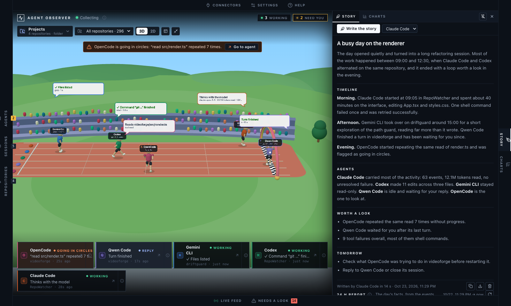
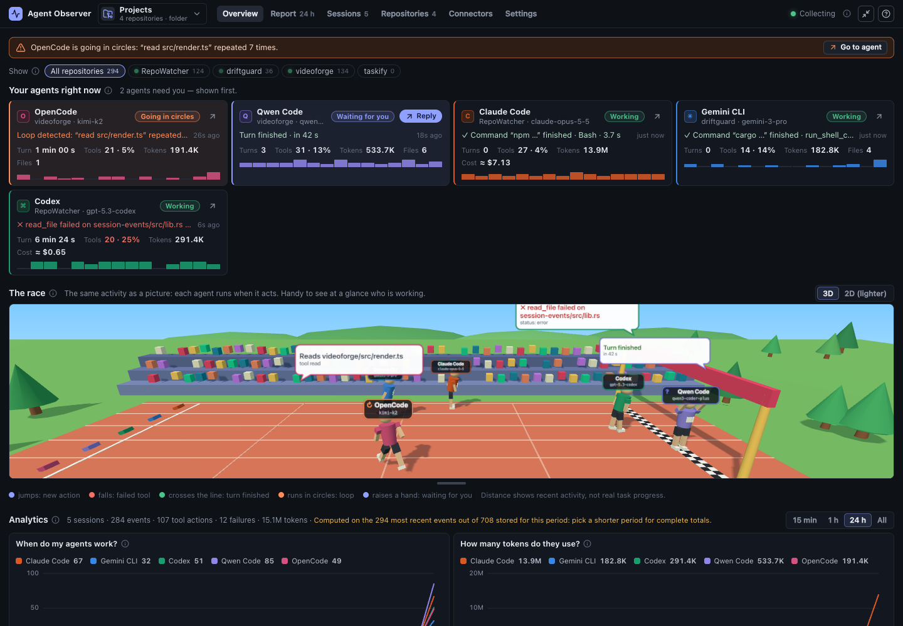
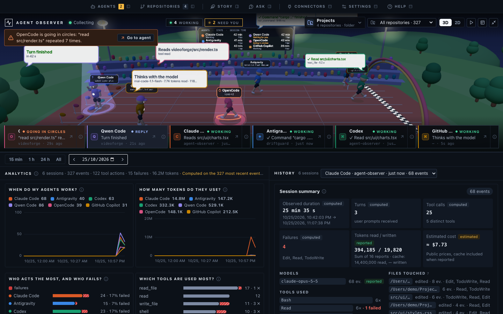
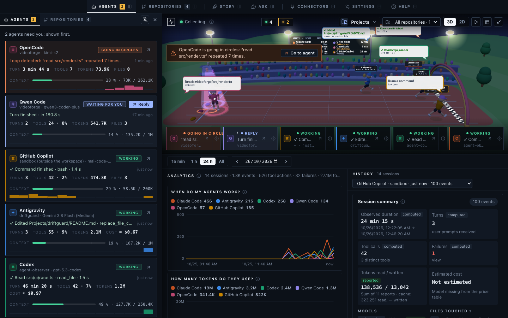
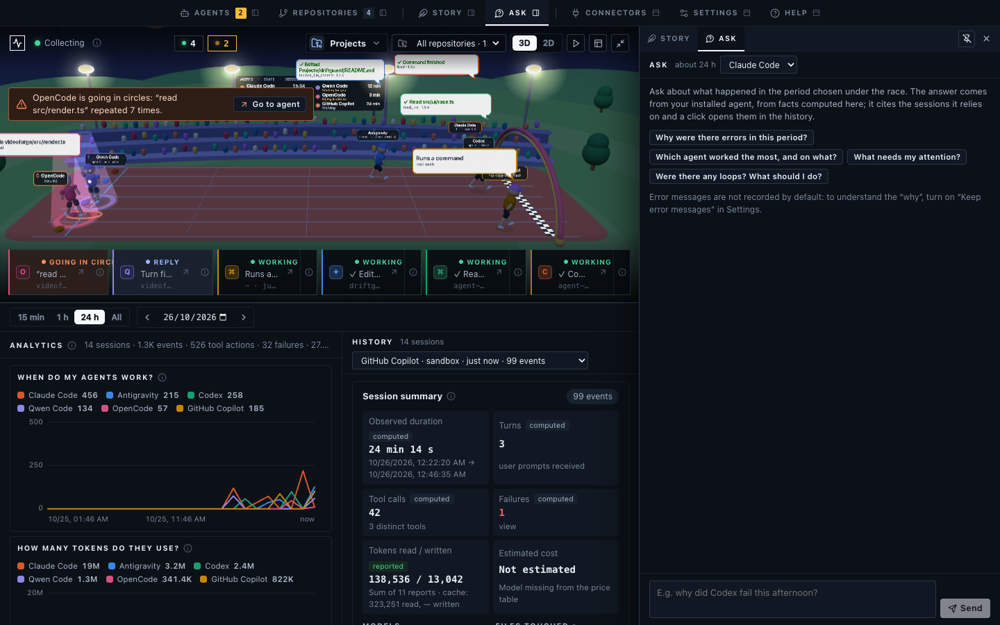
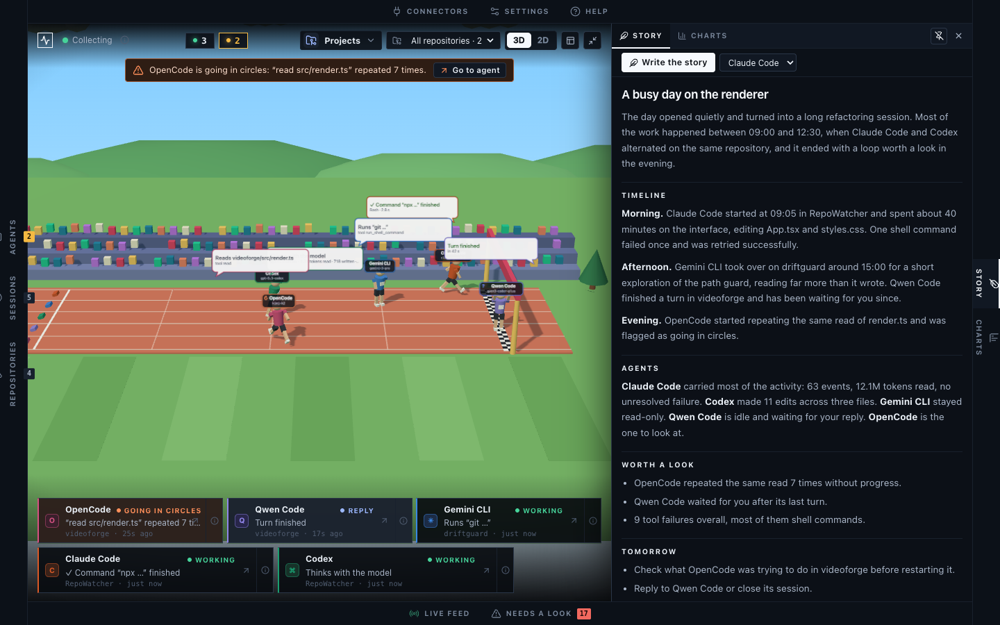
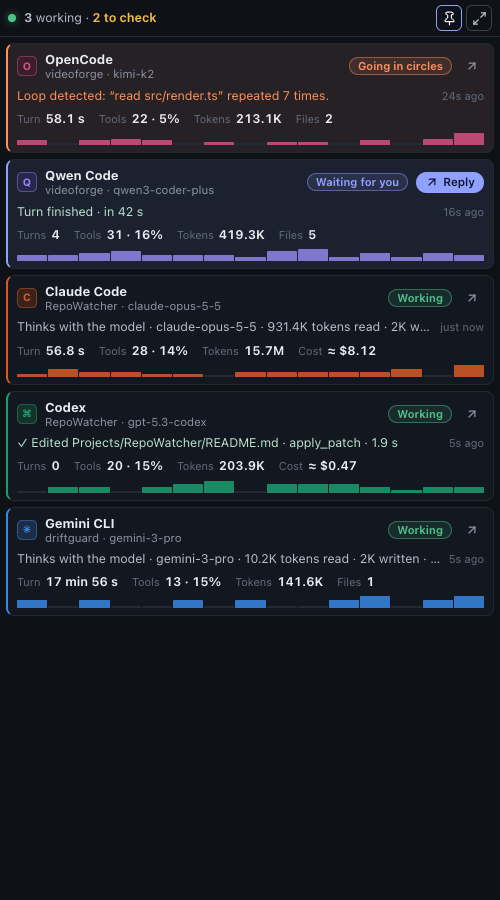

<div align="center">

# Agent Observer

**See what your coding agents are doing — and which one needs you — without sending anything anywhere.**

A local desktop app for macOS and Windows that watches Claude Code, Codex, Antigravity,
GitHub Copilot, OpenCode and Qwen Code work on your machine, live.

[](https://github.com/jcalhinho/agent-observer/actions/workflows/ci.yml)
[](https://github.com/jcalhinho/agent-observer/releases)
[](LICENSE)

[Download](#install) · [Features](#features) · [Privacy](#privacy) · [Build from source](#build-from-source) · [Contributing](CONTRIBUTING.md) · [Français](README.fr.md)



</div>

---

## Why

Running two or three coding agents in parallel is now normal. Knowing which one has
finished, which one is waiting for your approval and which one has been failing the same
command for five minutes is not. Agent Observer answers one question at a glance:
**who needs me right now?**

It only **observes**. It never drives an agent, never edits your code, never modifies an
agent's settings for you, and has no telemetry. The only time anything leaves your computer is when
you ask for the daily story: then an agent you already have is run once and talks to its own
provider, as it always does.

> **Status:** early (0.x). The interface is available in **English and French** (it follows
> your system language; change it in Settings). Contributions are welcome.

## Features

### The window: the race, then your data

The top bar holds every **tab**. Under it, the **race** takes at most **half** of the window (drag the
line under it to shrink it); under the race, the **workbench** shows **charts** and **history** side
by side for the period you choose.



### The race and the dock: who needs you

The race is a low-poly 3D stadium where each agent is a runner. Every event makes it hop, a failed tool
makes it fall and get back up, the end of a turn sends it to the finish line, an agent that waits for you
raises a hand, one that goes round in circles runs in circles. Everything is rounded and soft, and cheap
to draw: **Settings › Display › 3D race quality** (*Light*, *Automatic*, *Smooth*) trades sharpness for
speed on slower computers. A 2D version exists for machines without WebGL, and the race respects the
system's *reduced motion* setting. Distance is an activity indicator, never a completion percentage.

The scene carries more than movement, all computed from what the agents report:

| You see | It means |
| --- | --- |
| **Hurdles** ahead of it | One per failed tool of the last 15 minutes; a blocked agent has a wall of two bars. |
| **Flags** behind the start line | One per 30 minutes of the session. |
| The colour of the **cap** | The family of the model in use (Claude, Gemini, GPT, Qwen, GLM, DeepSeek, Copilot; grey when unknown). |
| A **spotlight** and a few seconds of camera | An agent that starts needing you. The camera leans in, then the wide shot returns. |
| **Confetti** / **fireworks** | 3 clean turns in a row / 6, or 3 after 30 minutes. An ordinary turn is not celebrated. |
| The **board** above the stands | Each agent, its state and its session time. |
| The **sky** | Follows your computer's time (dawn, day, dusk with floodlights, starry night); **Settings › Display › Race sky** fixes it. |

**Click a runner** to bring the camera close and open its card (session, token flow, failures, last actions,
*Go to the agent*); Esc or a click elsewhere closes it. The **▶ button** in the top bar replays the last hour
in 30 seconds.

Along the bottom of the race, one **chip per agent**, the ones that need attention first: what it is doing,
in which repository, how long ago. Click a chip to **go to the agent**; the small "i" opens its details.

| Status | Meaning |
| --- | --- |
| **Going in circles** | It repeats the same actions without progress (same command, same file, same sequence) — it burns tokens for nothing. |
| **Blocked** | At least two tools failed in a row. |
| **Silent** | A turn is open but nothing has happened for more than 2 minutes — often waiting for your approval. |
| **Waiting for you** | Its last turn has finished; it is ready for your next message. |
| **Working** | Events arrived in the last 45 seconds. |
| **Idle** | No recent activity. |
| **Not seen yet** | Nothing received — check its connector. |

Go to the agent brings its terminal, editor or desktop app (Claude Desktop, the Codex app, the VS Code and
Cursor extensions, Terminal, iTerm2, Windows Terminal…) to the front. If the agent has stopped, its session
is started again where it was seen, using only what is installed (its command line, its desktop app, or an
editor with its extension).

### Charts and history, by period or by day

The bar above them picks the period: the last **15 minutes**, **1 hour**, **24 hours**, **everything**, or a
**calendar day** (arrows and a date picker) — anything still in the local history, 30 days by default.

- **Charts**: activity and tokens over time, who acts the most and who fails, tools, files, turn durations,
  repositories. An **estimated** cost is shown for models with a published price in
  [`pricing.ts`](apps/desktop/src/ui/pricing.ts) — always "≈ $ at API price", never a bill (a per-agent
  setting calls it *value consumed* if you use a subscription). A value an agent does not report is shown as
  not provided, never guessed.
- **History**: the sessions of that period; pick one for its summary (duration, turns, tools, failures,
  tokens, cost, commits made during it) and its full timeline, which can be limited to what **needs a look**.



### Drawers: everything else

Each tab in the top bar opens a **drawer** that slides in from an edge — the icon next to the tab's name
shows which. Drag its inner edge to resize it, **pin** it so it keeps its place, press `Esc` to close the loose
ones.

| Edge | Tabs |
| --- | --- |
| **Left** | **Agents** (every card in full) · **Repositories** (branch, sync, agents per repository) |
| **Right** | **Story** (the 24 h story and report) · **Ask** (question the history) |
| **Top** | **Connectors** · **Settings** · **Help** |



### Ask: question the history

**Ask** answers questions like *"why were there errors this afternoon?"* or *"which agent worked the most?"*
with an agent you **already have**, for the period chosen under the race. The app selects the facts (sessions,
failures, waits, loops, costs); the answer cites the sessions it relies on as `[s3]` — a click opens them in
the history — and may end with **suggested next steps** you can copy to an agent. The app never sends
anything to an agent for you.

Each session in the facts lists the **files its agent edited** (so an answer can name them) and, for the main
sessions, the **subjects of the Git commits made while it ran** (read locally). That is how a question like
*"was this a fix or a feature?"* can be answered — as an inference: no agent records it, and a commit made during
a session is not proven to be the agent's.

Error messages are **not recorded** by default, so "why" can only be inferred. **Settings › What is recorded ›
Keep error messages** records a short (300 characters), single-line, cleaned version (keys, tokens, passwords
and your home folder removed) of the errors of failed tools — Claude Code, Codex, Antigravity, Qwen Code and OpenCode, for failures from now on.



### The daily story

An agent you **already have** — Claude Code, Codex, Gemini CLI, Qwen Code or OpenCode, as a command, an editor
extension or (for Claude) the desktop app — writes the story of your last 24 hours: on demand, and every day at
a time you choose (**18:00** by default). If the app was closed at that time, it is written at the next launch.



**How Ask and the story stay private.** The app computes a summary of facts (numbers and the names of projects,
models, tools, files and commit subjects — never the text of your messages, your commands or your folders). The agent is run
**once per request, with every tool switched off, in an empty folder, with no session kept**, and told to use
only those facts. Nothing is sent before you agree, once per agent, and you can read the exact summary first.
No key is needed and nothing extra is installed: it uses your plan.

### Context window

Each agent card shows **how full the context window is**: the size of the latest request (new tokens plus
those read from or written to the cache) against the size of the model's window, for example
`91 % · 909K / 1M`. The bar turns amber from 80 % and red from 95 %; the card of a focused runner adds the
trend over the session, the share served from the cache and the number of **compactions** (when the context
falls sharply). The window comes from the agent when it reports it (Codex, GitHub Copilot) and otherwise from
a small table of documented models; for a model that is in neither, the card says how many tokens the request
held and shows no percentage rather than a guess. What the context is made of (messages, tools, MCP…) is not
written to disk by any agent, so it is not shown.

### Notifications and alerts

A system notification when an agent waits for you, asks for approval, goes silent, keeps failing, goes round
in circles or has its context window past 80 %; clicking it takes you to the agent. Loops and errors also raise a red banner over the race. Every
kind can be switched off in Settings.

### Mini mode

Shrinks the app to a single always-visible column in a corner of the screen, one compact card per agent, with
an optional "keep on top" pin.



### Workspaces

Point the app at a folder (every Git repository up to four levels deep is found) or at a VS Code
`.code-workspace` file. Events are attached to the repository they happened in — worktrees count for the clone
they belong to — and the filter in the bar over the race scopes everything to one repository. Repositories are
read, never written, and Git changes are **never attributed to an agent** without evidence.


## Supported agents

| Agent | How it is observed | What you have to do |
| --- | --- | --- |
| **Claude Code** | Official [HTTP hooks](https://docs.claude.com/en/docs/claude-code/hooks) posted to the local collector, plus token usage read from new lines of its transcripts (`~/.claude/projects/**.jsonl`, `CLAUDE_CONFIG_DIR` respected). | Copy the settings fragment shown in the **Connectors** tab into `~/.claude/settings.json`. The app never edits it for you. |
| **Codex** | Appended JSONL rollout records in `~/.codex/sessions` (`CODEX_HOME` respected). | Nothing. |
| **Antigravity** | Its local files in `~/.gemini/antigravity`, opened **read-only**: the list of conversations (project, state, activity) and, for recent sessions, a step-by-step transcript (tokens, tools, failures). Older conversations are encrypted by Antigravity and only appear through the list. Antigravity only records a code for the selected model, so the app asks Antigravity's own local server (`127.0.0.1`, read-only, see [Privacy](#privacy)) for its name; the model is the one selected when a step was seen. Cost is estimated at API rates when the model is priced. | Nothing. |
| **GitHub Copilot** | The event logs of its agent in `~/.copilot/session-state/<session>/events.jsonl` (`COPILOT_HOME` respected): Copilot CLI and the agent sessions of VS Code, which run on it. Tokens, model, tool calls and failures. The older Copilot Chat panel (`chatSessions`) is not read. | Nothing. |
| **OpenCode** | Its local SQLite database (`~/.local/share/opencode/opencode*.db`, `OPENCODE_DB` / `OPENCODE_DATA_DIR` respected), opened **read-only**. | Nothing. |
| **Qwen Code** | Appended JSONL chat records in `~/.qwen/projects/<project>/chats`. | Nothing. |

On Windows, `~` is `%USERPROFILE%`. Log-based connectors start at the end of existing files
and observe new records only: history from before the app was started is not imported.

A Cursor hooks connector exists in the native runtime but is hidden from the interface for
now. GitHub Copilot, Cline, Roo Code, Continue and Aider are **not** connected yet — see
[adding a connector](#add-your-own-agent).

## Privacy

Everything stays on your computer. The app makes no network request of its own: it only
receives hooks on `127.0.0.1`. The only exceptions are the **daily story** and **Ask**, which are off until you
allow them for an agent: the app then runs that agent (already installed, with its own login)
once, with no tools, in an empty folder, on a summary of numbers and names; the agent sends it
to its provider like anything you type to it. You can read the exact summary before agreeing.

**One local request to Antigravity.** Its files hold only an internal code for the selected model, so, to show its name (and estimate a cost), the app asks Antigravity's own language server on `127.0.0.1` (read-only), using the token that app was started with, read from the process list and kept in memory for that one request. Only model names are kept from the answer. Nothing happens if Antigravity is not running.

**Recorded by default** — the *shape* of the work: which agent, which session, which tool,
which file path, when, how long, success or failure, model name and the token counts the
agent itself reports.

**Opt-in** (Settings, off by default) — the text of your prompts, and the shell commands
agents run. Both can contain secrets; enable them knowingly.

**Never recorded** — agent responses, reasoning / thinking, tool outputs and results, file
contents, transcript paths.

- Events are stored in a local SQLite database in the OS app-data directory
  (`~/Library/Application Support/dev.repowatcher.agentobserver/` on macOS,
  `%LOCALAPPDATA%\dev.repowatcher.agentobserver\` on Windows).
- Retention is configurable (7 days to forever); older events are purged at startup and
  every hour. History can be exported to JSON or erased from Settings.
- The hook collector listens on `127.0.0.1:43821` only and rejects requests without the
  per-installation bearer token generated on first launch.

See [SECURITY.md](SECURITY.md) for the threat model and how to report a vulnerability.

## Install

Download the latest installer from the [Releases page](https://github.com/jcalhinho/agent-observer/releases),
and check it against `SHA256SUMS.txt` from the same release.

| Platform | File |
| --- | --- |
| macOS, Apple Silicon (M1 and later) | `Agent-Observer_<version>_macos-arm64.dmg` |
| macOS, Intel | `Agent-Observer_<version>_macos-x64.dmg` |
| Windows 10/11, per-user install (recommended) | `Agent-Observer_<version>_windows-x64-setup.exe` |
| Windows 10/11, MSI for managed deployment | `Agent-Observer_<version>_windows-x64.msi` |

> [!IMPORTANT]
> Early releases are **not signed** with an Apple Developer ID or a Windows code-signing
> certificate yet, so your OS will warn you the first time. The steps below are the standard
> way to open an app you trust. If in doubt, [build it from source](#build-from-source).
> On a work computer, follow your organisation's software policy instead of bypassing it.

### macOS

1. Open the `.dmg` and drag **Agent Observer** into **Applications**.
2. Open it once from **Applications**. macOS says it cannot verify the developer.
3. Allow it, depending on your macOS version:
   - **macOS 15 Sequoia and later:** click **Done**, open **System Settings → Privacy &
     Security**, scroll down to the message about the app and click **Open Anyway**, then
     confirm with your password.
   - **macOS 14 and earlier:** in Finder, **right-click (or Control-click) the app → Open**,
     then **Open** in the dialog.

You only need to do this once. If macOS says the app **"is damaged and can't be opened"**,
it is the download quarantine flag on an unsigned app, not actual damage. Remove it in
Terminal:

```bash
xattr -dr com.apple.quarantine "/Applications/RepoWatcher Agent Observer.app"
```

### Windows

1. Run `…-setup.exe`. It installs for the current user, without administrator rights.
2. If **Microsoft Defender SmartScreen** shows *"Windows protected your PC"*, click
   **More info → Run anyway**.
3. WebView2 is already present on Windows 10/11; the installer fetches it if missing.

Verify the checksum in PowerShell before running it:

```powershell
Get-FileHash .\Agent-Observer_*_windows-x64-setup.exe -Algorithm SHA256
```

### First launch

1. **Connectors** tab: check that your agents are detected. For Claude Code, copy the
   displayed fragment into `~/.claude/settings.json` (the token in it is specific to this
   computer).
2. **Workspace** (top left): choose the folder that contains your projects.
3. Work as usual with your agents — the dashboard fills itself. The **?** button explains
   every status and number.

Only one instance runs at a time: launching it again brings the existing window forward.

## Build from source

Requirements: [Node.js 22](https://nodejs.org/), [Rust](https://rustup.rs/) stable (1.85 or
later) and the [Tauri 2 prerequisites](https://v2.tauri.app/start/prerequisites/) for your OS
(Xcode Command Line Tools on macOS; Microsoft C++ Build Tools and WebView2 on Windows;
WebKitGTK 4.1 on Linux).

```bash
git clone https://github.com/jcalhinho/agent-observer.git
cd agent-observer
npm ci
npm run desktop:dev      # development, with hot reload
npm run desktop:build    # installers in target/release/bundle/
```

On macOS, `npm run desktop:install-mac` builds the app and installs it into `/Applications`.
Linux builds from source but is not packaged or officially supported yet.

## Architecture

```
agent CLIs ──hooks (HTTP, 127.0.0.1 + token)──┐
           ──local logs / SQLite (read-only)──┤
                                              ▼
                      Rust connectors (apps/desktop/src-tauri/src/*_sessions.rs, codex_rollout.rs, …)
                                              │  SessionEvent (crates/session-events)
                                              ▼
                      SQLite store + Tauri commands/events (src-tauri/src/main.rs)
                                              │
                                              ▼
                      React UI (apps/desktop/src/ui) — cards, mini mode, race, analytics, workspaces
```

- **`crates/session-events`** — the provider-neutral event model shared by every connector.
  Each measured value carries its origin (`Provider`, `LocalObservation`, `Derived`,
  `Estimated`): a connector omits what
  it cannot observe rather than inventing it.
- **Connectors** (`apps/desktop/src-tauri/src/`) — one Rust module per agent that turns its
  hooks, JSONL logs or SQLite rows into `SessionEvent`s, dropping private content before
  anything is stored.
- **Desktop shell** — Tauri 2: the loopback collector (axum), the SQLite store (rusqlite),
  workspace and Git inspection (read-only), retention.
- **UI** — React 19 + Vite, charts in SVG, the race in three.js via react-three-fiber.
  Pure logic (statuses, analytics, pricing, workspace matching) lives in plain `.ts` modules
  with Vitest tests.

## Add your own agent

There are two ways to bring a new agent in:

- **Local HTTP API** — post events to the local collector from a script,
  a hook or a plugin, in any language. Documented in [`docs/CONNECTORS.md`](docs/CONNECTORS.md).
- **Native connector** — a Rust module in the desktop app. See
  [CONTRIBUTING.md](CONTRIBUTING.md#adding-a-connector).

Missing or wrong model price? Open a [model price issue](https://github.com/jcalhinho/agent-observer/issues/new?template=model_price.yml)
with a link to the provider's official pricing page.

## FAQ

**Does it send my code or prompts anywhere?**
No. There is no telemetry and the app makes no network request of its own. Prompts and
commands are not even stored locally unless you turn them on. If you ask for the daily story,
a summary of numbers and names (never your messages, commands or folders) goes through the agent
you chose, to its provider — only after you agreed, and you can read it first.

**Does it slow my agents down?**
Log connectors only read new lines of files the agents already write. Claude Code hooks are
fire-and-forget HTTP calls with a 2-second timeout; if the app is closed, Claude Code just
carries on.

**Why is the cost "estimated"?**
It is computed from public list prices and the token counts the agent reports. Subscriptions,
plans, discounts and batch pricing are unknown to the app. Models without a sourced price
show no cost at all.

**Why doesn't it show token counts for agent X?**
Because that agent doesn't report them in what the app can read. The app shows *not
provided* rather than an estimate.

**Can it see sessions started before I opened it?**
No. Connectors observe new activity from the moment the app runs; earlier history is not
imported. Everything observed since then stays available, within your retention setting.

**Port 43821 is already in use.**
Another copy of the app (or something else) holds it. Only one instance can collect hooks;
the Connectors tab shows the collector status.

**Why isn't the app signed?**
Code-signing certificates cost money and time; the release pipeline is ready to sign and
notarize as soon as they are available. Meanwhile every release ships SHA-256 checksums and
is built by GitHub Actions from the tagged source.

## Contributing

Bug reports, connector requests, model prices, translations and code are all welcome — start
with [CONTRIBUTING.md](CONTRIBUTING.md). Everyone taking part is expected to follow the
[Code of Conduct](CODE_OF_CONDUCT.md).

## License

[MIT](LICENSE). Agent Observer is an independent project, not affiliated with Anthropic,
OpenAI, Google, Alibaba or the OpenCode project. Product names belong to their owners.
