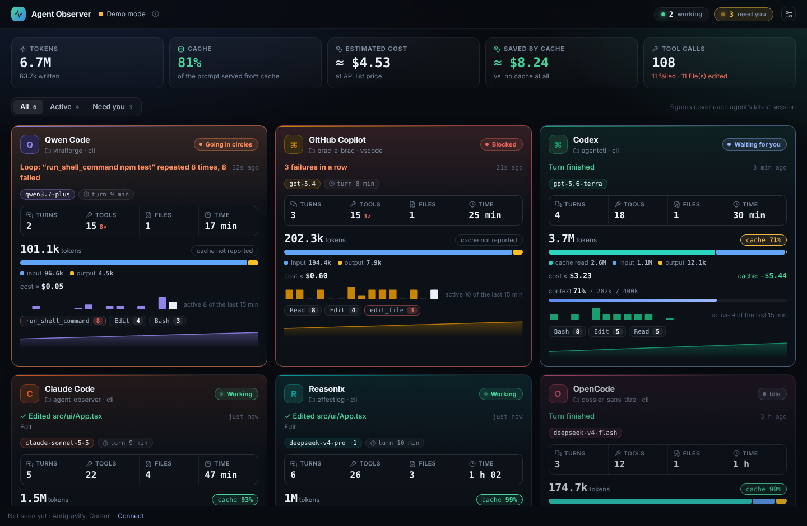
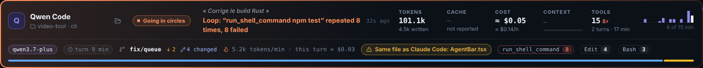
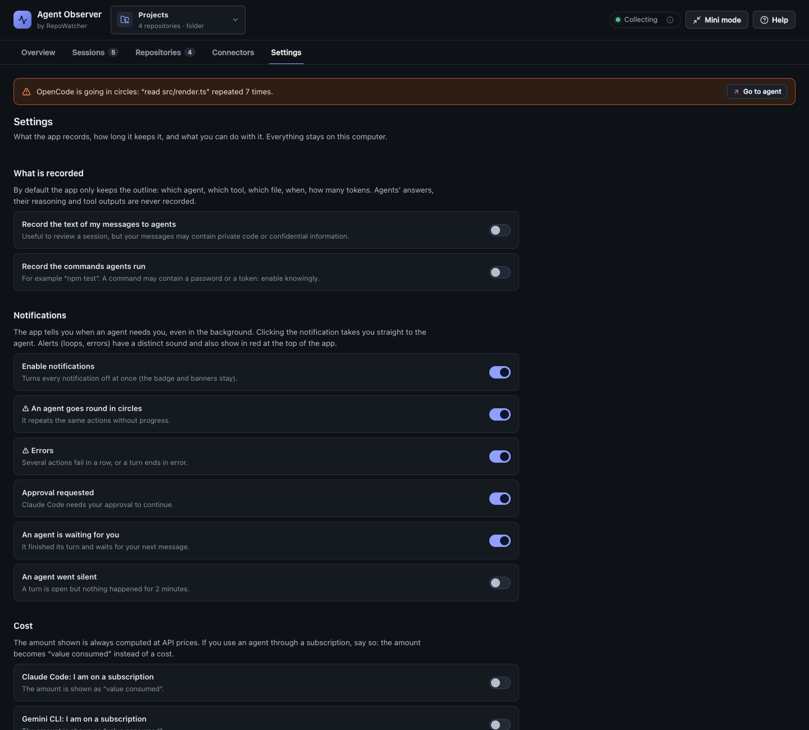

<div align="center">

# Agent Observer

**See what your coding agents are doing — and which one needs you — on one simple screen, without sending anything anywhere.**

A local desktop app for macOS and Windows that watches Claude Code, Codex, GitHub Copilot,
Antigravity, OpenCode, Qwen Code and Reasonix work on your machine, live.

[](https://github.com/jcalhinho/agent-observer/actions/workflows/ci.yml)
[](https://github.com/jcalhinho/agent-observer/releases)
[](LICENSE)

[Download](#install) · [What you see](#what-you-see) · [Privacy](#privacy) · [Build from source](#build-from-source) · [Contributing](CONTRIBUTING.md) · [Français](README.fr.md)



</div>

---

## Why

Running two or three coding agents in parallel is now normal. Knowing which one has
finished, which one is waiting for your approval and which one has been failing the same
command for five minutes is not. Agent Observer answers one question at a glance:
**who needs me right now?**

It only **observes**. It never drives an agent, never edits your code, never modifies an
agent's settings for you, and has no telemetry. It makes no network request of its own.

> **Status:** early (0.x). The interface is available in **English and French** (it follows
> your system language; change it in Settings).

## What you see

One screen, one card per agent. The most urgent cards come first. Each card answers eight
questions, and nothing else:

| # | Question | What the card shows |
| --- | --- | --- |
| 1 | **Who needs me?** | The state in one word, coloured by urgency. |
| 2 | **Who is working?** | Counted in the top bar, next to the number of agents that need you. |
| 3 | **What is it doing?** | The tool in progress and its file or command. |
| 4 | **Since when?** | How long ago the last activity was. |
| 5 | **Where?** | The project folder (`~` for your home folder, "deduced" when it comes from a file path). |
| 6 | **Is it going wrong?** | A detected loop or a series of failures, shown instead of the activity, in colour. |
| 7 | **How much does it use?** | Session tokens, and a bar showing how full the context window is. |
| 8 | **Which model?** | The latest model the agent reported (a `+` and a dashed chip when several were used), otherwise the configured one. The way it was launched (terminal, VS Code…) is shown next to it when known. |



| State | Meaning |
| --- | --- |
| **Going in circles** | It repeats the same actions without progress (same command, same file, same sequence) — it burns tokens for nothing. |
| **Blocked** | At least two tools failed in a row. |
| **Silent** | A turn is open but nothing has happened for more than 2 minutes — often waiting for your approval. |
| **Waiting for you** | Its last turn has finished; it is ready for your next message. |
| **Working** | Events arrived in the last 45 seconds. |
| **Idle** | No recent activity. |
| **Not seen yet** | Nothing received — check its connector. Listed in a small footer. |

The context bar turns amber from 80 % and red from 95 %. The window comes from the agent when it
reports it, otherwise from a small table of documented models; for an unknown model the card shows
the token count and no percentage rather than a guess.

### Settings

The button in the top bar opens a panel that slides in; close it and you are back on the single screen.

- **Connectors**: which agents are detected, and how to connect them (for Claude Code, the settings
  fragment to copy).
- **What is recorded**: prompts, shell commands and error messages are off by default.
- **Retention**: from 7 days to forever.
- **Export / erase** your local history.
- **Language**: English or French.



## Supported agents

| Agent | How it is observed | What you have to do |
| --- | --- | --- |
| **Claude Code** | Official [HTTP hooks](https://docs.claude.com/en/docs/claude-code/hooks) posted to the local collector, plus token usage read from new lines of its transcripts (`~/.claude/projects/**.jsonl`, `CLAUDE_CONFIG_DIR` respected). | Copy the settings fragment shown in **Settings › Connectors** into `~/.claude/settings.json`. The app never edits it for you. |
| **Codex** | Appended JSONL rollout records in `~/.codex/sessions` (`CODEX_HOME` respected). | Nothing. |
| **GitHub Copilot** | Two sources, both read-only: the event logs of its agent in `~/.copilot/session-state/<session>/events.jsonl` (Copilot CLI and the agent sessions of VS Code; `COPILOT_HOME` respected), and the Copilot Chat panel of VS Code (its local `session-store.db`: turns and files touched, never the assistant's text). | Nothing. |
| **Antigravity** | Its local files in `~/.gemini/antigravity`, opened **read-only**: the list of conversations and, for recent sessions, a step-by-step transcript (tokens, tools, failures). Antigravity only records a code for the selected model, so the app asks Antigravity's own local server (`127.0.0.1`, read-only, see [Privacy](#privacy)) for its name. | Nothing. |
| **OpenCode** | Its local SQLite database (`~/.local/share/opencode/opencode*.db`, `OPENCODE_DB` / `OPENCODE_DATA_DIR` respected), opened **read-only**. | Nothing. |
| **Qwen Code** | Appended JSONL chat records in `~/.qwen/projects/<project>/chats`. | Nothing. |
| **Reasonix** | Its session files in `~/.reasonix/projects/<project>/sessions/*.wire.jsonl` (written by Reasonix Studio), read-only. | Nothing. |
| **Cursor** | Cursor hooks posted to the local collector. | Copy the fragment shown in **Settings › Connectors**. |

On Windows, `~` is `%USERPROFILE%`. Log-based connectors start at the end of existing files
and observe new records only: history from before the app was started is not imported. The first
read of the Copilot Chat panel does the same, so a Copilot Chat card appears with your next conversation.

Not connected yet: Continue, Cline, Roo Code, Aider and Gemini CLI. Sessions run in a cloud
agent or a desktop app that keeps nothing on your computer cannot be observed. To add an
agent, see [adding a connector](#add-your-own-agent).

## Privacy

Everything stays on your computer. The app makes no network request of its own: it only
receives hooks on `127.0.0.1`.

**One local request to Antigravity.** Its files hold only an internal code for the selected model, so, to show its name, the app asks Antigravity's own language server on `127.0.0.1` (read-only), using the token that app was started with, read from the process list and kept in memory for that one request. Only model names are kept from the answer. Nothing happens if Antigravity is not running.

**Recorded by default** — the *shape* of the work: which agent, which session, which tool,
which file path, when, how long, success or failure, model name and the token counts the
agent itself reports.

**Opt-in** (Settings, off by default) — the text of your prompts, the shell commands
agents run, and a short cleaned version of error messages (keys, tokens, passwords and your
home folder removed). These can contain secrets; enable them knowingly.

**Never recorded** — agent responses, reasoning / thinking, tool outputs and results, file
contents, transcript paths.

- Events are stored in a local SQLite database in the OS app-data directory
  (`~/Library/Application Support/dev.repowatcher.agentobserver/` on macOS,
  `%LOCALAPPDATA%\dev.repowatcher.agentobserver\` on Windows).
- Retention is configurable (7 days to forever); older events are purged at startup and
  every hour. History can be exported to JSON or erased from Settings.
- The hook collector listens on `127.0.0.1:43821` only and rejects requests without the
  per-installation bearer token generated on first launch.

See [SECURITY.md](SECURITY.md) for the threat model and how to report a vulnerability.

## Install

Download the latest installer from the [Releases page](https://github.com/jcalhinho/agent-observer/releases),
and check it against `SHA256SUMS.txt` from the same release.

| Platform | File |
| --- | --- |
| macOS, Apple Silicon (M1 and later) | `Agent-Observer_<version>_macos-arm64.dmg` |
| macOS, Intel | `Agent-Observer_<version>_macos-x64.dmg` |
| Windows 10/11, per-user install (recommended) | `Agent-Observer_<version>_windows-x64-setup.exe` |
| Windows 10/11, MSI for managed deployment | `Agent-Observer_<version>_windows-x64.msi` |

> [!IMPORTANT]
> Early releases are **not signed** with an Apple Developer ID or a Windows code-signing
> certificate yet, so your OS will warn you the first time. The steps below are the standard
> way to open an app you trust. If in doubt, [build it from source](#build-from-source).
> On a work computer, follow your organisation's software policy instead of bypassing it.

### macOS

1. Open the `.dmg` and drag **Agent Observer** into **Applications**.
2. Open it once from **Applications**. macOS says it cannot verify the developer.
3. Allow it, depending on your macOS version:
   - **macOS 15 Sequoia and later:** click **Done**, open **System Settings → Privacy &
     Security**, scroll down to the message about the app and click **Open Anyway**, then
     confirm with your password.
   - **macOS 14 and earlier:** in Finder, **right-click (or Control-click) the app → Open**,
     then **Open** in the dialog.

You only need to do this once. If macOS says the app **"is damaged and can't be opened"**,
it is the download quarantine flag on an unsigned app, not actual damage. Remove it in
Terminal:

```bash
xattr -dr com.apple.quarantine "/Applications/RepoWatcher Agent Observer.app"
```

### Windows

1. Run `…-setup.exe`. It installs for the current user, without administrator rights.
2. If **Microsoft Defender SmartScreen** shows *"Windows protected your PC"*, click
   **More info → Run anyway**.
3. WebView2 is already present on Windows 10/11; the installer fetches it if missing.

Using it on Windows and something looks off? [`docs/WINDOWS.md`](docs/WINDOWS.md) is a short checklist of what to expect for each agent.

Verify the checksum in PowerShell before running it:

```powershell
Get-FileHash .\Agent-Observer_*_windows-x64-setup.exe -Algorithm SHA256
```

### First launch

1. Open **Settings** (top right) and check that your agents are detected. For Claude Code, copy the
   displayed fragment into `~/.claude/settings.json` (the token in it is specific to this
   computer).
2. Work as usual with your agents — the cards fill themselves.

Only one instance runs at a time: launching it again brings the existing window forward.

## Build from source

Requirements: [Node.js 22](https://nodejs.org/), [Rust](https://rustup.rs/) stable (1.85 or
later) and the [Tauri 2 prerequisites](https://v2.tauri.app/start/prerequisites/) for your OS
(Xcode Command Line Tools on macOS; Microsoft C++ Build Tools and WebView2 on Windows;
WebKitGTK 4.1 on Linux).

```bash
git clone https://github.com/jcalhinho/agent-observer.git
cd agent-observer
npm ci
npm run desktop:dev      # development, with hot reload
npm run desktop:build    # installers in target/release/bundle/
```

Tests: `npm test` in `apps/desktop` for the interface, `cargo test` in `apps/desktop/src-tauri` for the Rust side.
Linux builds from source but is not packaged or officially supported yet. [`COMPRENDRE.md`](COMPRENDRE.md)
(in French) is a three-minute tour of the code.

## Architecture

```
agent CLIs ──hooks (HTTP, 127.0.0.1 + token)──┐
           ──local logs / SQLite (read-only)──┤
                                              ▼
                      Rust readers (apps/desktop/src-tauri/src/*_sessions.rs, codex_rollout.rs, copilot_chat.rs, …)
                                              │  SessionEvent (crates/session-events)
                                              ▼
                      SQLite store + Tauri commands/events (src-tauri/src/main.rs)
                                              │
                                              ▼
                      React UI (apps/desktop/src/ui) — one screen, one card per agent
```

- **`crates/session-events`** — the provider-neutral event model shared by every reader.
  Each measured value carries its origin (`Provider`, `LocalObservation`, `Derived`,
  `Estimated`): a reader omits what it cannot observe rather than inventing it.
- **Readers** (`apps/desktop/src-tauri/src/`) — one Rust module per agent that turns its
  hooks, JSONL logs or SQLite rows into `SessionEvent`s, dropping private content before
  anything is stored.
- **Desktop shell** — Tauri 2: the loopback collector (axum) and the SQLite store (rusqlite).
- **UI** — React 19 + Vite. The state of an agent (`agentPulse.ts`), loop detection, context
  usage and session totals live in plain `.ts` modules with Vitest tests.

## Add your own agent

- **Local HTTP API** — post events to the local collector from a script,
  a hook or a plugin, in any language. Documented in [`docs/CONNECTORS.md`](docs/CONNECTORS.md).
- **Native reader** — a Rust module in the desktop app. See
  [CONTRIBUTING.md](CONTRIBUTING.md#adding-a-connector).

## FAQ

**Does it send my code or prompts anywhere?**
No. There is no telemetry and the app makes no network request of its own. Prompts and
commands are not even stored locally unless you turn them on.

**Does it slow my agents down?**
Log readers only read new lines of files the agents already write. Claude Code hooks are
fire-and-forget HTTP calls with a 2-second timeout; if the app is closed, Claude Code just
carries on.

**Why doesn't a card show token counts?**
Because that agent doesn't report them in what the app can read. The app shows *not
provided* rather than an estimate.

**Can it see sessions started before I opened it?**
No. Readers observe new activity from the moment the app runs; earlier history is not
imported. Everything observed since then stays available, within your retention setting.

**Port 43821 is already in use.**
Another copy of the app (or something else) holds it. Only one instance can collect hooks;
Settings › Connectors shows the collector status.

**Why isn't the app signed?**
Code-signing certificates cost money and time; the release pipeline is ready to sign and
notarize as soon as they are available. Meanwhile every release ships SHA-256 checksums and
is built by GitHub Actions from the tagged source.

## Contributing

Bug reports, connector requests, translations and code are all welcome — start
with [CONTRIBUTING.md](CONTRIBUTING.md). Everyone taking part is expected to follow the
[Code of Conduct](CODE_OF_CONDUCT.md).

## License

[MIT](LICENSE). Agent Observer is an independent project, not affiliated with Anthropic,
OpenAI, Google, GitHub, Alibaba or the OpenCode project. Product names belong to their owners.
